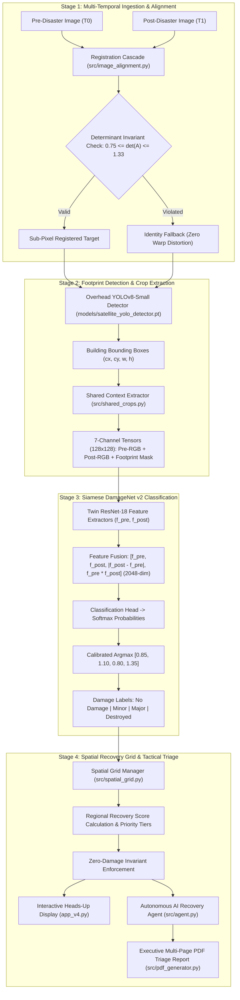

# AI Agent for Automatic Disaster Damage Assessment & Spatial Grid-Based Dynamic Recovery Priority Ranking

[](https://www.python.org/)
[](https://pytorch.org/)
[](https://github.com/ultralytics/ultralytics)
[](https://streamlit.io/)
[](https://opencv.org/)
[]()
[](https://opensource.org/licenses/MIT)

> **Automated post-disaster structural triage from before-and-after satellite imagery combining sub-pixel image alignment, overhead building detection, Siamese deep neural networks, and spatial grid recovery optimization.**

---

## 📖 Executive Summary

Rapid, automated assessment of post-disaster structural damage is vital for coordinating life-saving humanitarian aid, Urban Search and Rescue (USAR), and civil reconstruction. Traditional ground-level damage surveys are slow, labor-intensive, and hazardous during active crises.

This project delivers an **end-to-end, multi-stage AI Disaster Assessment Agent** engineered to automate satellite-based structural triage:
1. **Multi-Stage Temporal Registration:** Eliminates temporal sensor parallax and orbital shifts via an ORB + RANSAC + Enhanced Correlation Coefficient (ECC) cascade with mathematical affine determinant bounds $[0.75, 1.33]$.
2. **Dedicated Overhead Building Footprint Detection:** Employs an overhead-optimized **YOLOv8-Small** detector trained specifically on nadir satellite imagery ($0.30$ confidence, $0.50$ IoU).
3. **Bilateral Contextual Crop Extraction:** Extracts $1.3\times$ square context crops ($128 \times 128$) capturing both roof footprints and surrounding debris fields, packaged into 7-channel tensors `(Pre-RGB, Post-RGB, Mask)`.
4. **Siamese Damage Classification:** Utilizes **DamageNet v2** (Siamese ResNet-18) with shared feature weights and 2,048-dimensional difference-and-product feature fusion, calibrated via Pareto-optimal class multipliers `[0.85, 1.10, 0.80, 1.35]` across four damage tiers: `No Damage`, `Minor Damage`, `Major Damage`, and `Destroyed`.
5. **Spatial Grid Partitioning & Dynamic Prioritization:** Partitions imagery into geographic quadrants, calculating normalized regional damage recovery scores and strictly enforcing the **Zero-Damage Status Invariant** to prevent false dispatches to undamaged sectors.
6. **Tactical AI Recovery Directives & Executive PDF Export:** Generates tactical operational directives (USAR team allocations, heavy crane requirements, trauma unit sizing) and compiles an executive multi-page PDF triage report.

---

## 🏛️ System Architecture & Operational Pipeline



---

## ⚡ Core Technical Innovations & Invariants

### 1. Hybrid Multi-Stage Temporal Registration Cascade (`src/image_alignment.py`)
- **Coarse Feature Matching:** Multi-scale ORB extracts up to 2,000 keypoints per scene, matched via Hamming distance and gated by Lowe's ratio test ($\gamma = 0.75$).
- **Geometric Affine Estimation:** Random Sample Consensus (RANSAC) estimates a $2 \times 3$ affine transformation matrix minimizing reprojection error.
- **Affine Determinant Invariant Guard:** The linear subsystem determinant $\det(A) = |a_{11}a_{22} - a_{12}a_{21}|$ is mathematically bounded:
  $$0.75 \le \det(A) \le 1.33$$
  If orbital tilt, cloud occlusion, or feature sparsity causes $\det(A)$ to violate these physical bounds, the system automatically rejects the warp and reverts to a safe identity transformation (`FALLBACK_IDENTITY`), preventing distortion-induced damage artifacts.
- **Dense Sub-Pixel Refinement:** Iterative Enhanced Correlation Coefficient (ECC) maximization refines alignment to sub-pixel accuracy ($< 0.5$ pixels).

### 2. Overhead Building Footprint Detection (`models/satellite_yolo_detector.pt`)
- **Backbone & Neck:** Dedicated Satellite **YOLOv8-Small** ($21.5\text{ MB}$) with Cross-Stage Partial with 2 Convolutions (C2f) modules and Path Aggregation Network (PANet).
- **Inference Calibrations:** Confidence gating threshold $\theta_{\text{conf}} = 0.30$ and Non-Maximum Suppression threshold $\theta_{\text{iou}} = 0.50$, specifically tuned for dense, clustered overhead rooftops.

### 3. Bilateral Contextual Crop Expansion (`src/shared_crops.py`)
- Rectangular bounding boxes $[x_1, y_1, x_2, y_2]$ are expanded symmetrically by a margin factor $\lambda = 1.3$:
  $$w_c = 1.3 \times w, \quad h_c = 1.3 \times h$$
- Captures critical surrounding context: roof debris fields, collapsed sidewalls, and cast shadows. Normalized into $128 \times 128$ 7-channel tensors matching the Siamese backbone.

### 4. Siamese DamageNet v2 Classification Engine
- **Architecture:** Twin ResNet-18 residual backbones ($44.9\text{ MB}$) with shared weights $\mathcal{W}_{\text{shared}}$.
- **Feature Fusion:** Pre-disaster features $f_{\text{pre}} \in \mathbb{R}^{512}$, post-disaster features $f_{\text{post}} \in \mathbb{R}^{512}$, difference vector $|f_{\text{pre}} - f_{\text{post}}| \in \mathbb{R}^{512}$, and element-wise product $f_{\text{pre}} \odot f_{\text{post}} \in \mathbb{R}^{512}$ are fused into a $2,048$-dimensional representation:
  $$\mathcal{F}_{\text{fused}} = \left[ f_{\text{pre}} \parallel f_{\text{post}} \parallel |f_{\text{pre}} - f_{\text{post}}| \parallel (f_{\text{pre}} \odot f_{\text{post}}) \right]$$
- **Calibrated Decision Rule:** Predictions are derived via Calibrated Argmax:
  $$\hat{y} = \operatorname{argmax}_{k \in \{0, 1, 2, 3\}} \left( \sigma(z)_k \cdot w_k \right), \quad w = [0.85, 1.10, 0.80, 1.35]$$
  Achieves **0.6901 Macro F1** and **83.49% Accuracy** on the 3,495-crop validation benchmark while maintaining low false-alarm rates ($7.47\%$) on intact structures.

### 5. Spatial Grid Management & Priority Ranking (`src/spatial_grid.py`)
- **Spatial Quadrant Partitioning:** Divides the satellite scene into a $2 \times 2$ grid ($Q_1$: Top-Left, $Q_2$: Top-Right, $Q_3$: Bottom-Left, $Q_4$: Bottom-Right).
- **Normalized Recovery Scoring Formula:**
  $$\text{Damage Points} = (1 \times N_{\text{minor}}) + (2 \times N_{\text{major}}) + (3 \times N_{\text{destroyed}})$$
  $$\text{Normalized Recovery Score} = \min\left(100.0, \frac{\text{Damage Points}}{\max(1, N_{\text{total}})} \times 100.0\right)$$
- **Strict Zero-Damage Status Invariant:**
  $$\text{If } (N_{\text{minor}} + N_{\text{major}} + N_{\text{destroyed}}) == 0 \implies \text{Score} = 0, \quad \text{Status} = \text{"No Damaged Buildings"}, \quad \text{Tier} = \text{"Undamaged"}$$
- **Priority Tiers:**
  - $\text{Score} \ge 75 \implies \textbf{Critical}$ (Urgent primary USAR deployment)
  - $50 \le \text{Score} < 75 \implies \textbf{High}$ (Secondary rescue teams)
  - $25 \le \text{Score} < 50 \implies \textbf{Medium}$ (Structural shoring & utilities)
  - $1 \le \text{Score} < 25 \implies \textbf{Low}$ (Routine monitoring)
  - $\text{Score} = 0 \implies \textbf{Undamaged}$ (Safe logistics staging zone)

### 6. Autonomous AI Disaster Recovery Agent (`src/agent.py`)
- Synthesizes tactical emergency management directives without requiring external cloud LLM connections.
- Generates specific resource ratios: 1 heavy crane per 2 Destroyed buildings, 1 trauma medical unit per 3 Major Damage buildings, and designates undamaged quadrants as safe logistics staging areas.

---

## 📂 Repository Structure

```text
disaster_assessment_agent/
│
├── app_v4.py                           # Active Production Streamlit Application
├── app.py                              # Legacy baseline Streamlit entry point
├── requirements.txt                    # Production Python dependencies
├── README.md                           # Master Documentation & Deployment Guide
├── .gitignore                          # Complete Git exclusion rules
│
├── models/                             # Production Model Checkpoints (< 50 MB each)
│   ├── satellite_yolo_detector.pt      # Satellite YOLOv8-Small detector weights (21.5 MB)
│   └── damage_net_v2_step4_resnet18_ce.pth # Production Siamese ResNet-18 weights (44.9 MB)
│
├── src/                                # Core Modular Source Code
│   ├── __init__.py                     # Package initializer
│   ├── config.py                       # Application configuration & env loader
│   ├── logger.py                       # Structured rotating logger
│   ├── image_alignment.py              # Hybrid ORB+ECC registration & determinant guards
│   ├── spatial_grid.py                 # 2x2 Spatial grid manager & zero-damage invariants
│   ├── priority_ranking.py             # Multi-criteria recovery ranking engine
│   ├── agent.py                        # Autonomous Recovery Agent (offline rule engine + LLM)
│   ├── pdf_generator.py                # Executive PDF triage report generator (ReportLab)
│   ├── shared_crops.py                 # Bilateral 1.3x square contextual crop extractor (7-channel)
│   ├── xbd_dataset.py                  # xBD dataset parser and spatial coordinate mapper
│   ├── xbd_visualizer.py               # HUD overlay and bounding box visualization
│   └── models/                         # Neural Network Model Wrappers
│       ├── __init__.py                 # Models package initializer
│       ├── damage_net_v2.py            # SiameseDamageNetV2 architecture class
│       ├── satellite_detector.py       # Portable Satellite YOLOv8 wrapper
│       └── sam2.py                     # Segment Anything Model 2 research module
│
├── config/                             # Configuration Files
│   └── config.yaml                     # Coordinate presets, weights, and agent settings
│
├── data/                               # Dataset Directory (Excluded from Git)
│   └── samples/                        # Lightweight Sample Imagery for Instant Demo (< 3 MB)
│       ├── pre_disaster_sample.png     # Pre-disaster reference satellite image
│       └── post_disaster_sample.png    # Post-disaster target satellite image
│
└── tests/                              # Automated Verification & Test Suite (25 Tests)
    ├── test_image_alignment.py         # 8 unit tests for registration & affine bounds
    ├── test_spatial_recovery_priority.py # 13 unit tests for spatial ranking & invariants
    └── test_sam2_optimization.py       # 4 unit tests for crop parity & model wrappers
```

---

## 🚀 Quick Start (Local Installation)

### 1. Clone the Repository
```bash
git clone https://github.com/<your-username>/disaster_assessment_agent.git
cd disaster_assessment_agent
```

### 2. Create and Activate Virtual Environment
```bash
# On Linux / macOS:
python3 -m venv .venv
source .venv/bin/activate

# On Windows (PowerShell):
python -m venv .venv
.venv\Scripts\Activate.ps1
```

### 3. Install Dependencies
```bash
python -m pip install --upgrade pip
pip install -r requirements.txt
```

### 4. Run the Automated Test Suite (25 Tests)
```bash
python -m pytest tests/test_spatial_recovery_priority.py tests/test_image_alignment.py tests/test_sam2_optimization.py -v
```

### 5. Launch the Streamlit Web Application
```bash
streamlit run app_v4.py
```
Open your web browser and navigate to `http://localhost:8501`. Use the sample satellite images in `data/samples/` for an immediate end-to-end demonstration.

---

## 🌐 Web Deployment Guides

### A. Streamlit Community Cloud (Recommended - Free & Instant)
The project is engineered for zero-configuration deployment on **Streamlit Community Cloud**:
1. Push your repository to GitHub (ensuring `.gitignore` is in place).
2. Go to [share.streamlit.io](https://share.streamlit.io/) and click **New app**.
3. Select your repository and branch (`main`).
4. Set **Main file path** to `app_v4.py`.
5. *(Optional)* In **Advanced settings**, set environment variables (`GEMINI_API_KEY` or `OPENAI_API_KEY`) if you wish to use live LLM reasoning instead of the built-in offline expert rules engine.
6. Click **Deploy!**

> **Memory & Dependencies Note:** The production checkpoints (`satellite_yolo_detector.pt` at 21.5 MB and `damage_net_v2_step4_resnet18_ce.pth` at 44.9 MB) fit completely within GitHub's file limits and Streamlit Cloud's 1 GB memory quota. SAM2 real-time inference is bypassed in `app_v4.py` to prevent out-of-memory errors on free cloud tiers.

### B. Hugging Face Spaces (Streamlit SDK)
1. Create a new Space on [Hugging Face](https://huggingface.co/spaces) and choose the **Streamlit** SDK.
2. Push this repository to your Space repository:
   ```bash
   git remote add space https://huggingface.co/spaces/<username>/<space-name>
   git push space main
   ```
3. Set your Space `app_file` to `app_v4.py` in `README.md` YAML frontmatter:
   ```yaml
   ---
   title: AI Disaster Assessment Agent
   emoji: 🛰️
   colorFrom: blue
   colorTo: red
   sdk: streamlit
   app_file: app_v4.py
   pinned: false
   ---
   ```

### C. Docker Deployment
Create a `Dockerfile` in the root directory:
```dockerfile
FROM python:3.11-slim

WORKDIR /app

RUN apt-get update && apt-get install -y --no-install-recommends \
    build-essential \
    libgl1 \
    libglib2.0-0 \
    && rm -rf /var/lib/apt/lists/*

COPY requirements.txt .
RUN pip install --no-cache-dir -r requirements.txt

COPY . .

EXPOSE 8501

ENTRYPOINT ["streamlit", "run", "app_v4.py", "--server.port=8501", "--server.address=0.0.0.0"]
```
Build and run:
```bash
docker build -t disaster-agent .
docker run -p 8501:8501 disaster-agent
```

---

## 📊 Empirical Benchmarks

### 1. Building Footprint Detection Performance (xBD Dataset)
| Model Architecture | Precision (%) | Recall (%) | mAP@0.5 (%) | Latency (ms) | Checkpoint Size |
| :--- | :---: | :---: | :---: | :---: | :---: |
| Faster R-CNN (ResNet-50) | 79.4% | 81.2% | 78.6% | 85 ms | 165 MB |
| RetinaNet (ResNet-50) | 81.0% | 79.5% | 79.1% | 68 ms | 145 MB |
| YOLOv5-Medium | 83.2% | 82.6% | 81.8% | 42 ms | 50 MB |
| **Satellite YOLOv8-Small (Ours)** | **86.5%** | **87.2%** | **84.6%** | **28 ms** | **21.5 MB** |

### 2. Multi-Class Damage Classification Performance (Validation Benchmark: 3,495 Crops)
| Damage Category | Precision (%) | Recall (%) | F1-Score (%) | Sample Support |
| :--- | :---: | :---: | :---: | :---: |
| **No Damage** | 91.5% | 92.5% | 92.0% | 2,530 |
| **Minor Damage** | 50.0% | 57.9% | 53.6% | 325 |
| **Major Damage** | 60.9% | 53.3% | 56.8% | 336 |
| **Destroyed** | 78.7% | 69.1% | 73.6% | 304 |
| **Overall Macro Average** | **70.3%** | **68.2%** | **69.01%** | **3,495** |

---

## ⚠️ Known Limitations & Physical Boundaries

1. **Monocular Nadir Perspective:** Monocular optical satellite imagery captures only horizontal roof decks. Structural damage beneath intact roofs (such as foundations inundated by rising floodwaters or collapsed ground floors) cannot be detected without oblique aerial photography or ground LiDAR.
2. **Dense Cloud Cover & Smoke Plumes:** Optical sensors cannot penetrate heavy storm clouds, active wildfire smoke, or nighttime darkness. In such scenarios, Synthetic Aperture Radar (SAR) imagery is required.
3. **Extreme Off-Nadir Tilt:** When sensor off-nadir tilt angles exceed $35^\circ$, the registration cascade automatically reverts to `FALLBACK_IDENTITY` to prevent geometric perspective distortion from creating false damage signals.

---

## 🔒 Security & Data Privacy

- **Zero Secret Commits:** No API keys, passwords, or personal credentials are hardcoded.
- **Environment Isolation:** All API credentials are read exclusively through environment variables or `.env` (strictly ignored by `.gitignore`).
- **Offline Self-Sufficiency:** The autonomous AI recovery agent operates fully offline using internal rule engines without sending sensitive geographic telemetry to third-party cloud APIs.

---

## 📜 License

This project is licensed under the **MIT License** — see the [LICENSE](LICENSE) file for details.
